<div align="center">


# LogicLens

**Camera-to-correction for PLC ladder logic.**

Paste rungs or drop a screenshot. LogicLens finds the bugs, explains them, proposes fixes,
exports IEC 61131-3 Structured Text and simulates the scan.


[Quick start](#quick-start) · [How it works](#how-it-works) · [Architecture](#architecture) · [Results](#measured-results) · [Testing](#how-its-tested)

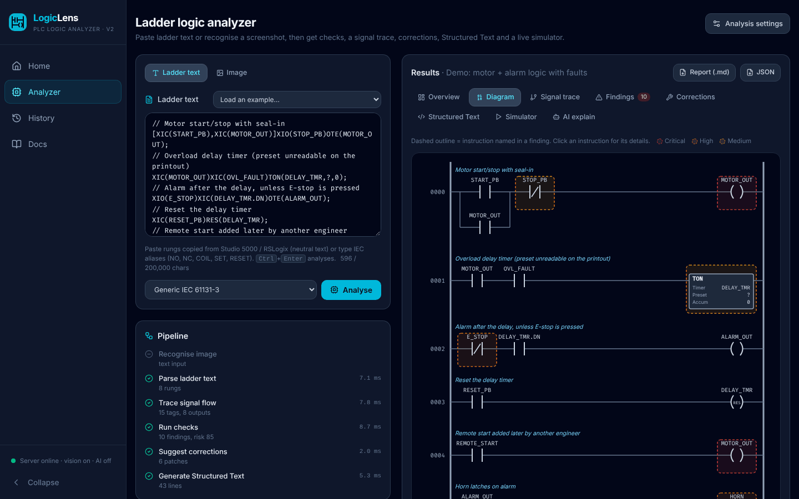

</div>

## Why

Ladder logic still runs most machines, and it is usually reviewed by eye. Programs often reach
the person reviewing them as screenshots or printouts, not as project files. The same few mistakes
cause real downtime: a coil written in two places, a normally-closed stop button examined with the
wrong contact, an alarm latched and never cleared, an emergency stop handled in standard logic.

LogicLens automates that first review:

- **Reads screenshots and photos.** A YOLOv8 detector and OCR (or Claude vision) turn an image into ladder text. You review it before anything is analysed, and `?` marks anything that could not be read.
- **Finds faults.** 32 checks, mapped to a 19-item review checklist, give one risk score.
- **Explains every finding.** Each one shows the rule, the rungs involved, why it matters, how to fix it and the relevant standard.
- **Traces signals.** For every output it shows which inputs drive it.
- **Proposes corrections** as patches you can review and apply.
- **Exports Structured Text** (IEC 61131-3). The generated code is checked against the simulator in the test suite.
- **Simulates the scan** with normally-open (NO) and normally-closed (NC) field wiring, so you can watch power flow rung by rung.
- **Runs in your browser** and works offline. Images are processed in memory and never stored. Claude explanations are optional.

## Screenshots

<table>
<tr>
<td width="50%">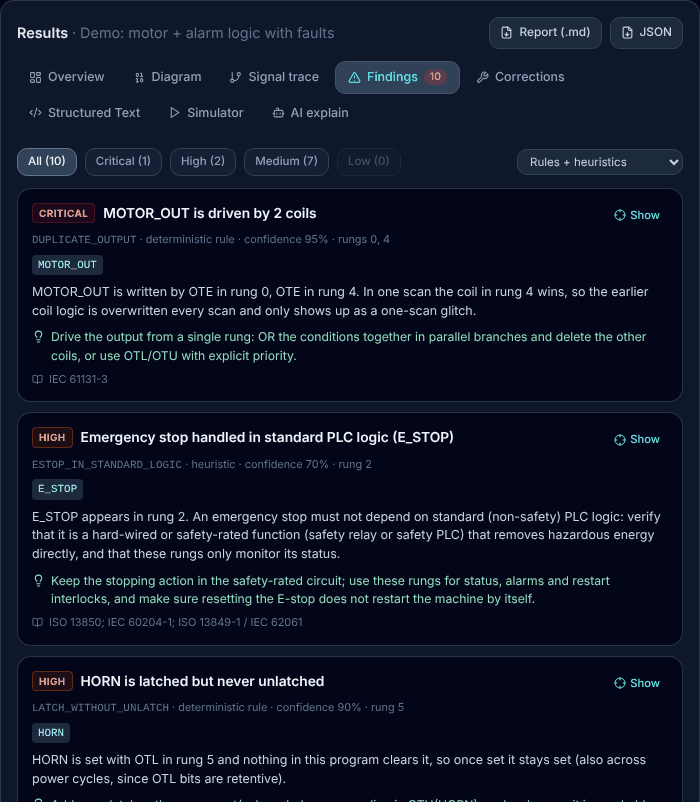<br><sub><b>Findings</b>: severity, rule, rungs, why it matters and how to fix it</sub></td>
<td width="50%">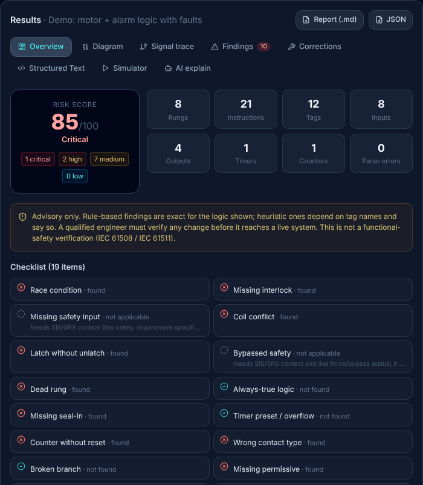<br><sub><b>Overview</b>: risk score, program statistics and the 19-item checklist</sub></td>
</tr>
<tr>
<td width="50%">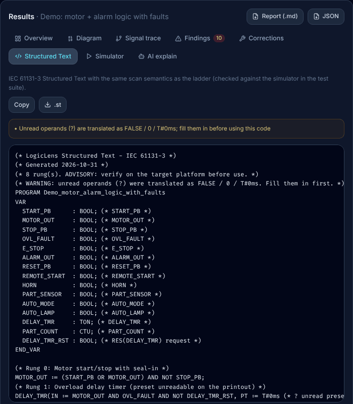<br><sub><b>Structured Text</b>: IEC 61131-3 with the same scan semantics as the ladder</sub></td>
<td width="50%">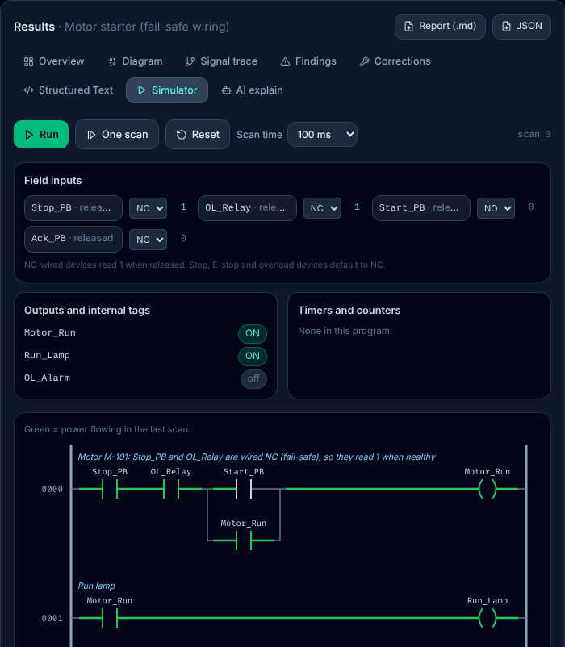<br><sub><b>Simulator</b>: press Start, release it, and the seal-in keeps the motor running</sub></td>
</tr>
</table>

### From a screenshot to an analysis

<table>
<tr>
<td width="40%">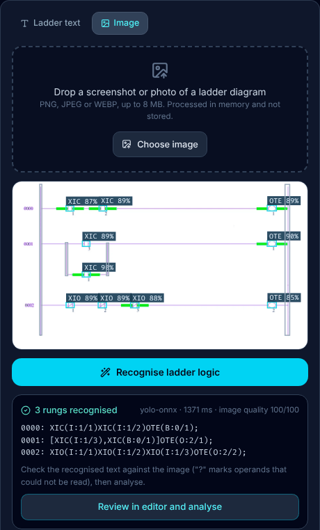</td>
<td width="60%">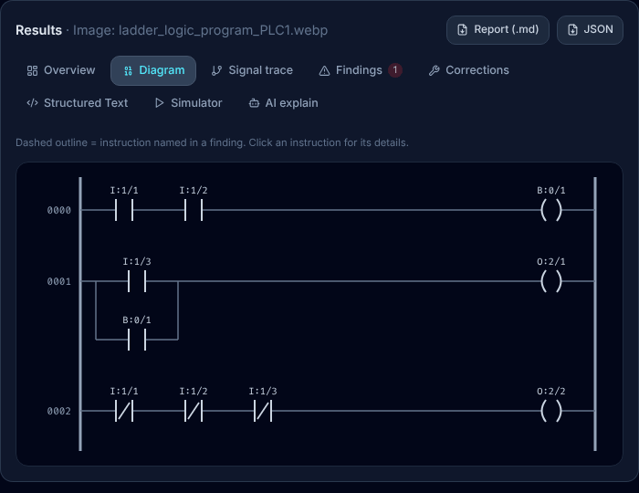</td>
</tr>
<tr>
<td><sub>1. A real RSLogix 500 screenshot: every symbol detected, every operand read</sub></td>
<td><sub>2. The recognised program, redrawn and analysed</sub></td>
</tr>
</table>

```text
0000: XIC(I:1/1)XIC(I:1/2)OTE(B:0/1);
0001: [XIC(I:1/3),XIC(B:0/1)]OTE(O:2/1);
0002: XIO(I:1/1)XIO(I:1/2)XIO(I:1/3)OTE(O:2/2);
```

The recognised text above matches the hand-written ground truth exactly
([`ml/reports/sample_prediction.json`](ml/reports/sample_prediction.json)).

## Quick start

| Option | How | Needs |
|---|---|---|
| **No install** | Open [`LogicLens.html`](LogicLens.html) in a browser: the whole app in one file | A browser |
| **Windows, full app** | Double-click [`Start-LogicLens.cmd`](Start-LogicLens.cmd) | Node.js 20+, Python 3.11 to 3.13, [Tesseract OCR](https://github.com/UB-Mannheim/tesseract/wiki) for tag names |
| **Docker** | `docker compose up --build`, then open http://localhost:8080 | Docker |

`LogicLens.html` runs text analysis, all checks, Structured Text and the simulator offline.
Screenshot recognition and AI need the API, which the other two options start.

On its first start, `Start-LogicLens.cmd` installs the web packages (1 to 2 minutes) and the API's
Python packages (2 to 5 minutes, in the "LogicLens API" window). After that it starts in seconds
and opens http://localhost:5173. Close both windows to stop. Double-clicking it again while
LogicLens is running just reopens the browser.

Manual setup is under [Development](#development).

## How it works

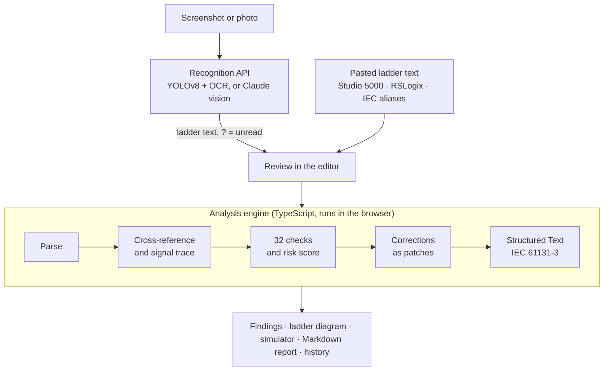

Input is **LogicLens Ladder Text**: the neutral text that Studio 5000 and RSLogix copy to the
clipboard, plus IEC aliases (`NO`, `NC`, `COIL`, `SET`, `RESET`). The grammar, limits and error
codes are in [`contract/README.md`](contract/README.md). The TypeScript and Python parsers share
37 test vectors and must agree on every one.

```text
// Motor start/stop with seal-in
[XIC(START_PB),XIC(MOTOR_OUT)]XIO(STOP_PB)OTE(MOTOR_OUT);
// Overload delay timer (preset unreadable on the printout)
XIC(MOTOR_OUT)XIC(OVL_FAULT)TON(DELAY_TMR,?,0);
```

On the built-in demo program (8 rungs) LogicLens reports a risk score of 85/100: 1 critical,
2 high and 7 medium findings, with 6 suggested patches.

## What it checks

| Area | Checks |
|---|---|
| Outputs and coils | `DUPLICATE_OUTPUT` · `MIXED_OUTPUT_TYPES` · `LATCH_WITHOUT_UNLATCH` · `UNLATCH_WITHOUT_LATCH` · `UNCONDITIONAL_OUTPUT` · `MISSING_SEAL_IN` |
| Safety | `ESTOP_IN_STANDARD_LOGIC` · `STOP_EXAMINED_WITH_XIO` · `MISSING_INTERLOCK` · `BRANCH_BYPASSED` |
| Logic (satisfiability) | `DEAD_RUNG` · `CONTRADICTORY_CONTACTS` · `ALWAYS_TRUE` · `REDUNDANT_CONTACT` · `SCAN_ORDER_DELAY` |
| Timers and counters | `TIMER_INSTANCE_REUSED` · `TIMER_PRESET_INVALID` · `UNDEFINED_TIMER_REFERENCE` · `RTO_NO_RESET` · `COUNTER_PRESET_INVALID` · `COUNTER_NO_RESET` · `ONE_SHOT_STORAGE_REUSED` |
| Program flow | `JUMP_TARGET_MISSING` · `LABEL_DUPLICATE` · `LBL_NOT_FIRST` · `BACKWARD_JUMP` · `MCR_UNBALANCED` |
| Data | `DIVIDE_BY_ZERO` · `UNKNOWN_OPERANDS` |
| Maintainability | `UNUSED_INTERNAL` · `MISSING_COMMENT` · `NAMING_INCONSISTENCY` |

Each check is either a deterministic rule (exact for the logic shown) or a heuristic that depends
on tag names, and every finding says which one it is. The risk score combines all findings, with
weights $w$ = 0.45 (critical), 0.25 (high), 0.10 (medium) and 0.02 (low):

$$\text{risk} = 100 \times \Big(1 - \prod_{\text{findings}} (1 - w)\Big)$$

## Architecture

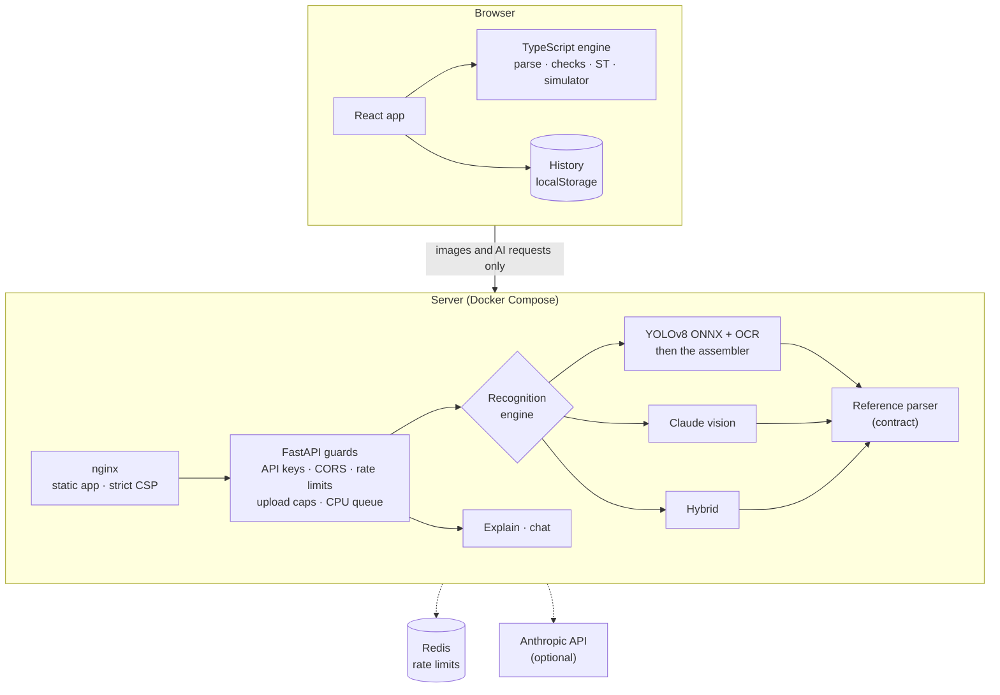

- **The analysis never leaves the browser.** The server is only needed to read images and for the optional AI features.
- **Four recognition engines.**
  - `yolo-onnx`: detector plus OCR, CPU only.
  - `claude-vision`: Claude reads the image.
  - `hybrid`: YOLO boxes guide Claude's reading, and each half falls back to the other.
  - `stub`: for demos.
  - `LOGICLENS_ENGINE=auto` picks the best engine that is configured.
- **Hardened uploads with zero retention.**
  - Uploads are streamed with a size cap, checked by magic bytes and decoded with pixel caps to stop decompression bombs.
  - Images are never written to disk.
  - A bounded CPU queue answers `503` with `Retry-After` instead of falling over, and the web app retries.
- **Security in depth.** The API supports optional API keys, Redis-backed rate limits (separate ones for AI calls) and a CORS allow-list. nginx applies a strict Content Security Policy, and the containers run read-only.

### Screenshot recognition, step by step

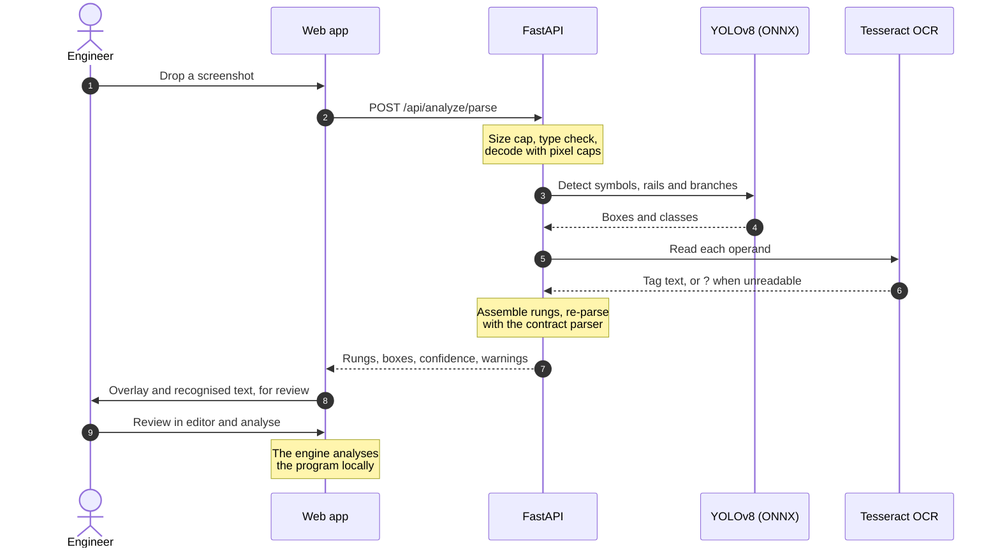

## The model

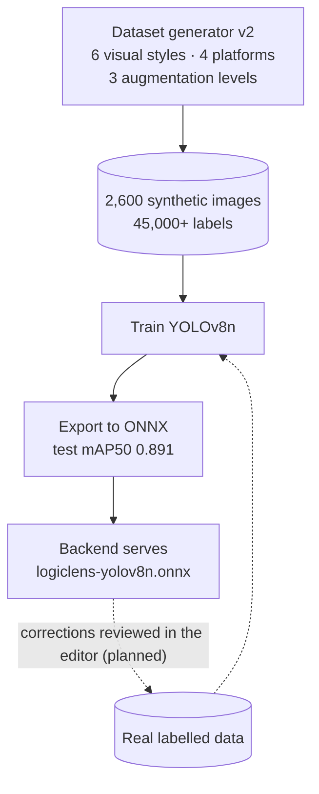

The generator in [`ml/generator/`](ml/generator) draws ladder diagrams the way real tools do:

- **Visual styles:** Studio 5000, RSLogix 500, TIA Portal, IEC, dark themes and printed pages.
- **Labels:** tight boxes for every symbol, plus the power rails and branch connectors that the assembler needs to rebuild rungs.

Details are in [`ml/models/model_card.md`](ml/models/model_card.md) and
[`ml/reports/dataset_report.md`](ml/reports/dataset_report.md).

## Measured results

| What | Result | Source |
|---|---|---|
| Detector, synthetic test split (300 images) | mAP50 0.891 · mAP50-95 0.821 · precision 0.84 · recall 0.86 | [`metrics.json`](ml/models/metrics.json) |
| Real RSLogix 500 screenshot | All 3 rungs and every operand exact | [`sample_prediction.json`](ml/reports/sample_prediction.json) |
| End to end, 150 synthetic test images | Instruction F1 0.84 · operands read 44 % · whole program exact 2.7 % | [`e2e_eval.json`](ml/reports/e2e_eval.json) |
| Analysis of a 2,000-rung program | About 0.55 s in the browser | [`performance.test.ts`](web/tests/integration/engine/performance.test.ts) |
| Text API under load | 800 virtual users · about 990 requests/s · p95 310 ms · 0 errors | Load test (gate 6) |
| Image recognition under load | About 1.8 images/s on 2 CPU cores · 0 failed requests | Load test (gate 6) |

The detector finds the symbols well. Reading the small operand text is the weak link. That is why
recognised programs open in the editor for review, with `?` marking anything unread, and why the
hybrid engine exists: YOLO finds the boxes and Claude reads them.

## How it's tested

Every package went through the same six gates:

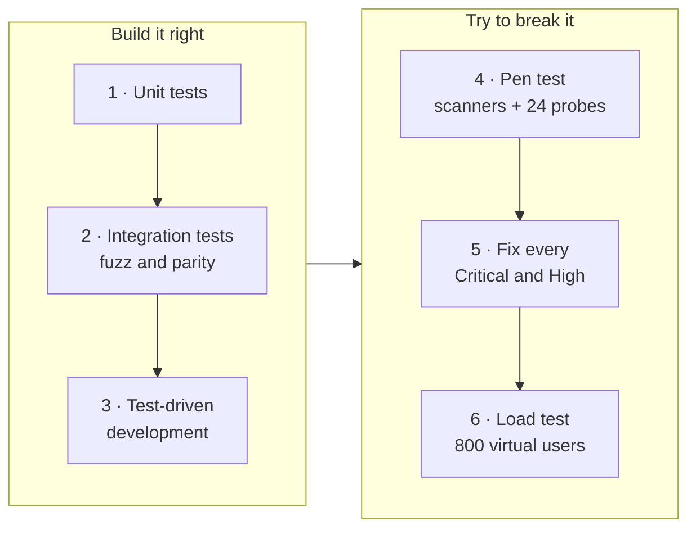

| Package | Tests | Highlights |
|---|---|---|
| `web/` | 379 | Engine line coverage 98.6 %. TS and Python parsers agree on 3,000 generated inputs. 2,000 random programs × 200 scans of fuzzing. Generated Structured Text matches the simulator on 600 random programs |
| `backend/` | 352 | Integration runs against real Tesseract, onnxruntime and Redis. Security probes cover uploads, decompression bombs, CORS, spoofed forwarding headers and auth |
| `ml/` | 144 + 3 expected failures | Generator, decoder parity with the backend, end-to-end evaluation |
| `contract/` | 72 | Reference parser and the shared test vectors |

**Security.** Scanned with npm audit, pip-audit, bandit and semgrep (OWASP rules), plus 24 hand-written API probes.

- All Critical and High findings were fixed: 1 Critical and 3 High.
- Of 8 Medium findings, 6 were fixed and 1 was a false positive.
- 1 Medium is still open: the Claude paths need a probe with a live API key.

## Development

```bash
# Web app: http://localhost:5173 (proxies /api to 127.0.0.1:8000)
cd web && npm ci && npm run dev
npm test                      # unit + integration
npm run build:standalone      # rebuilds LogicLens.html

# API: Python 3.11 to 3.13, Tesseract on PATH for tag names
cd backend && pip install -r requirements.txt
LOGICLENS_YOLO_ONNX=../ml/models/logiclens-yolov8n.onnx python -m uvicorn app.main:app --port 8000
python -m pytest
```

The npm scripts call `node node_modules/...` directly on purpose. npm's Windows `.cmd` shims
break in folders whose path contains `&`.

### API

| Method | Path | Purpose |
|---|---|---|
| `GET` | `/health` | Liveness and version |
| `GET` | `/api/meta` | Active engine, limits, AI status |
| `POST` | `/api/analyze/parse` | Image to program JSON (multipart `file`, optional `platform`) |
| `POST` | `/api/analyze/text` | Ladder text to program JSON |
| `POST` | `/api/analyze/explain` | Claude explanation of a program and its findings |
| `POST` | `/api/chat` | Follow-up questions about a program |

Every error uses one envelope, `{"error": {"code", "message", "request_id", "details"}}`, described in
[`contract/README.md`](contract/README.md#5-error-envelope-all-backend-errors).

### Configuration

| Variable | Default | Purpose |
|---|---|---|
| `LOGICLENS_ENGINE` | `auto` | `auto`, `yolo`, `claude`, `hybrid` or `stub` |
| `LOGICLENS_YOLO_ONNX` | not set | Path to the detector, e.g. `ml/models/logiclens-yolov8n.onnx` |
| `ANTHROPIC_API_KEY` | not set | Turns on Claude vision, explain and chat |
| `LOGICLENS_API_KEYS` | not set (open) | Comma-separated keys that clients send in `X-API-Key` |
| `REDIS_URL` | not set (in-memory) | Shared rate limits across workers |
| `LOGICLENS_CORS_ORIGINS` | `http://localhost:5173` | Allowed browser origins |
| `LOGICLENS_OCR` / `LOGICLENS_TESSERACT_CMD` | `true` / `tesseract` | Operand OCR |
| `LOGICLENS_MAX_UPLOAD_MB` | `8` | Upload cap |
| `LOGICLENS_DOCS` | `false` | Serves the OpenAPI docs at `/docs` |

### Project structure

```text
├── contract/             Ladder text grammar, program JSON schema, detector classes, shared test vectors
├── web/                  React app + TypeScript engine (parse, trace, checks, corrections, ST, simulator)
├── backend/              FastAPI: recognition engines, Claude explain/chat, security, Dockerfile
├── ml/                   Dataset generator, training / export / evaluation tools, pilot ONNX model
├── samples/              Real RSLogix 500 screenshot used in tests
├── docs/images/          README screenshots
├── LogicLens.html        Single-file build: open it, no install
├── Start-LogicLens.cmd   Windows launcher
└── docker-compose.yml    nginx + FastAPI + Redis
```

## Roadmap

- **Real training data.** Synthetic data took the pilot to 0.89 mAP50. Real HMI photos and IDE screenshots with corrected labels are what will raise end-to-end accuracy. Every correction made in the editor is such a label, collected with consent.
- **Hybrid engine in production.** It is implemented and tested against a fake client. Next is a live-key probe before users see it.
- **Hosted SaaS.** Accounts and billing.
- **Android.** The web app is an installable PWA. Next is a Capacitor or Trusted Web Activity wrapper for the Play Store.

## Safety

LogicLens is advisory. It does not certify safety functions (IEC 61508 / IEC 61511) and cannot see
field wiring or hardware configuration. A qualified engineer must verify any change before it
reaches a live system. Emergency stops belong in hard-wired or safety-rated circuits, which is also
what the `ESTOP_IN_STANDARD_LOGIC` check says.

## License

Copyright (C) 2026 Mahim Trivedi.

LogicLens is free software under the [GNU Affero General Public License v3.0](LICENSE). If you run a
modified version as a network service, you must offer its source code to the users of that service.
The pilot detector is trained with [Ultralytics YOLOv8](https://github.com/ultralytics/ultralytics),
which is also AGPL-3.0.
