<div align="center">


# LogicLens

**Camera-to-correction for PLC ladder logic.**

Paste rungs or drop a screenshot. LogicLens finds the bugs, explains them, proposes fixes,
exports IEC 61131-3 Structured Text and simulates the scan.


[App tour](#app-tour) · [Quick start](#quick-start) · [How it works](#how-it-works) · [Architecture](#architecture) · [Results](#measured-results) · [Testing](#how-its-tested)

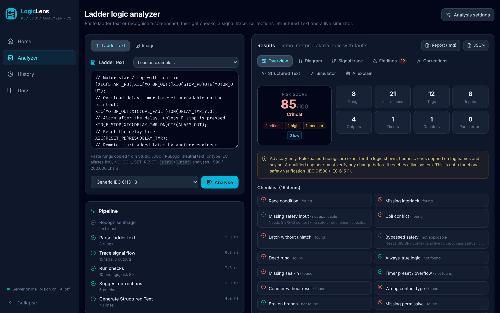

</div>

## Why

Ladder logic still runs most machines, and it is usually reviewed by eye. Programs often reach
the person reviewing them as screenshots or printouts, not as project files. The same few mistakes
cause real downtime: a coil written in two places, a normally-closed stop button examined with the
wrong contact, an alarm latched and never cleared, an emergency stop handled in standard logic.

LogicLens automates that first review:

- **Reads screenshots and photos.** A YOLOv8 detector and OCR (or Claude vision) turn an image into ladder text. You review it before anything is analysed, and `?` marks anything that could not be read.
- **Finds faults.** 32 checks, mapped to a 19-item review checklist, give one risk score.
- **Explains every finding.** Each one shows the rule, the rungs involved, why it matters, how to fix it and the relevant standard.
- **Traces signals.** For every output it shows which inputs drive it.
- **Proposes corrections** as patches you can review and apply.
- **Exports Structured Text** (IEC 61131-3). The generated code is checked against the simulator in the test suite.
- **Simulates the scan** with normally-open (NO) and normally-closed (NC) field wiring, so you can watch power flow rung by rung.
- **Runs in your browser** and works offline. Images are processed in memory and never stored. Claude explanations are optional.

## App tour

Real screenshots of LogicLens running, with a pink number on each part of the screen. The table
under each screenshot explains every number. Click a screenshot to see it full size.

[1 Home](#1-home-page) · [2 Analyzer](#2-analyzer-paste-a-program-and-analyse) · [3 Findings](#3-findings) ·
[4 Diagram](#4-ladder-diagram) · [5 Signal trace](#5-signal-trace) · [6 Corrections](#6-corrections) ·
[7 Structured Text](#7-structured-text) · [8 Simulator](#8-simulator) ·
[9 Recognise a screenshot](#9-screenshot-recognition-step-1-recognise) ·
[10 Analyse it](#10-screenshot-recognition-step-2-analyse) · [11 History](#11-history)

### 1. Home page

The landing page. One click loads a faulty demo program and analyses it.

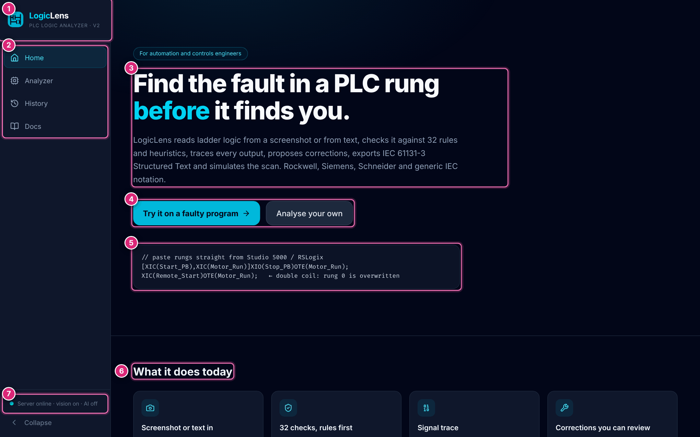

| # | What you see | What it means |
|---|---|---|
| 1 | Logo and version | LogicLens, version 2. Shown on every page. |
| 2 | Main menu | **Home**; **Analyzer**, the workbench; **History**, past analyses kept in your browser; **Docs**, the ladder text format and the list of checks. |
| 3 | Headline and summary | What LogicLens does: reads ladder logic from a screenshot or text, checks it against 32 rules and heuristics, traces every output, proposes corrections, exports Structured Text and simulates the scan. |
| 4 | Start buttons | **Try it on a faulty program** opens the Analyzer with a demo full of common field mistakes. **Analyse your own** opens it empty. |
| 5 | Example input | The input format: rungs copied straight from Studio 5000 or RSLogix. The second rung writes `Motor_Run` again, the double-coil mistake LogicLens catches. |
| 6 | Feature cards | The main features at a glance: screenshot or text in, 32 checks, signal trace, corrections. |
| 7 | Server status | Green means the recognition server is reachable. "vision on" means screenshot recognition is ready. "AI off" means no Claude key is configured. Text analysis works even without a server. |

### 2. Analyzer: paste a program and analyse

The demo program after **Analyse**. Input is on the left and results are on the right. This is the
**Overview** tab.

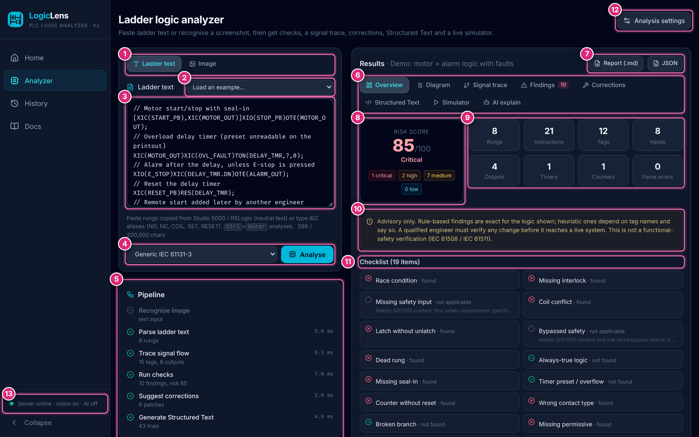

| # | What you see | What it means |
|---|---|---|
| 1 | Input type | **Ladder text** to paste a program, **Image** to recognise a screenshot (steps 9 and 10). |
| 2 | Load an example | Six built-in programs, from this faulty demo to a bottle-filling line. |
| 3 | Ladder text editor | One rung per line, `//` for comments, `[ , ]` for parallel branches. Syntax mistakes are reported as you type. |
| 4 | Platform and Analyse | The notation: Rockwell, Siemens, Schneider, Mitsubishi, Omron or generic IEC. **Analyse**, or Ctrl+Enter, runs everything. |
| 5 | Pipeline | Each stage with its time: recognise image (skipped for text), parse, trace, checks, corrections, Structured Text. The whole analysis takes milliseconds and runs in the browser. |
| 6 | Result tabs | Overview, Diagram, Signal trace, Findings (10), Corrections, Structured Text, Simulator, AI explain. |
| 7 | Export | Downloads a Markdown report or the full analysis as JSON. |
| 8 | Risk score | 0 to 100, combining all findings weighted by severity. Here it is 85, Critical: 1 critical, 2 high and 7 medium findings. |
| 9 | Program statistics | Rungs, instructions, tags, inputs, outputs, timers, counters and parse errors. |
| 10 | Advisory note | Rule-based findings are exact for the logic shown. Heuristic ones depend on tag names. A qualified engineer verifies any change. This is not a functional-safety verification. |
| 11 | Review checklist | The 19-item review checklist. Each item is marked found, not found or not applicable. Some items need safety context that a program alone cannot give. |
| 12 | Analysis settings | Optional context for the AI, an API key if the server requires one, and a button that checks the server again. |
| 13 | Server status | As on the home page. |

### 3. Findings

Every problem found, most severe first.

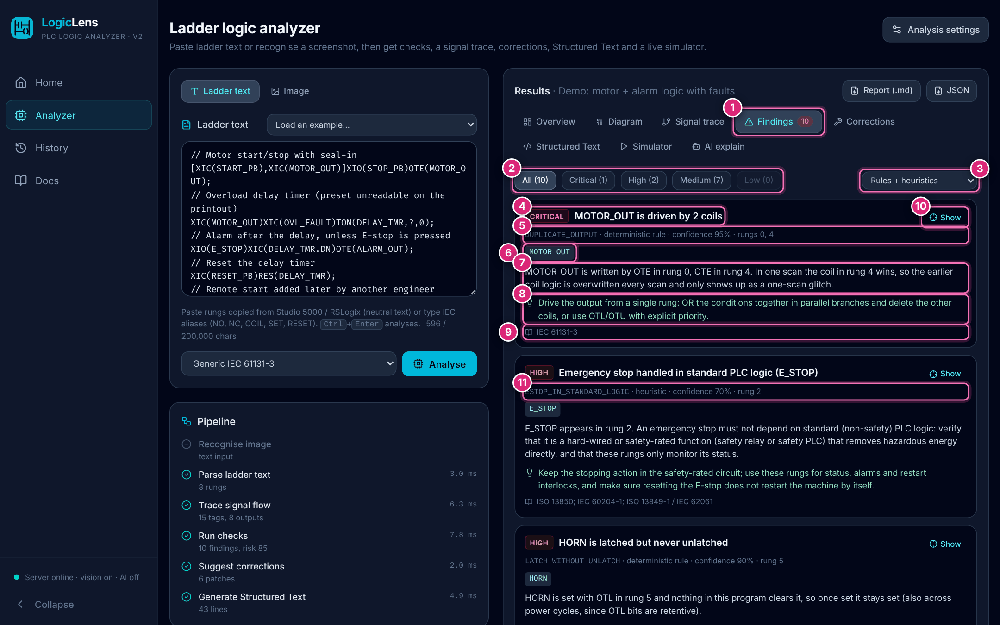

| # | What you see | What it means |
|---|---|---|
| 1 | Findings tab | The badge counts the findings (10). |
| 2 | Severity filter | Shows all findings, or only the critical, high, medium or low ones. |
| 3 | Basis filter | Rules and heuristics, deterministic rules only, or heuristics only. |
| 4 | Severity and title | **CRITICAL**: MOTOR_OUT is driven by 2 coils. |
| 5 | Rule details | Rule ID (`DUPLICATE_OUTPUT`), whether it is a deterministic rule or a heuristic, the confidence, and the rungs involved (0 and 4). |
| 6 | Tags involved | The tag this finding is about. |
| 7 | Explanation | What is wrong and why it matters. The coil in rung 4 overwrites rung 0 on every scan, so rung 0's logic only shows up as a one-scan glitch. |
| 8 | How to fix it | The recommended change. |
| 9 | Standard | The standard behind the check, IEC 61131-3 here. |
| 10 | Show | Jumps to the flagged instructions in the ladder diagram. |
| 11 | A heuristic finding | `ESTOP_IN_STANDARD_LOGIC` is a heuristic with 70 % confidence. It relies on the tag name E_STOP, and the finding says so. |

### 4. Ladder diagram

The program redrawn as a ladder diagram, with the findings marked on it.

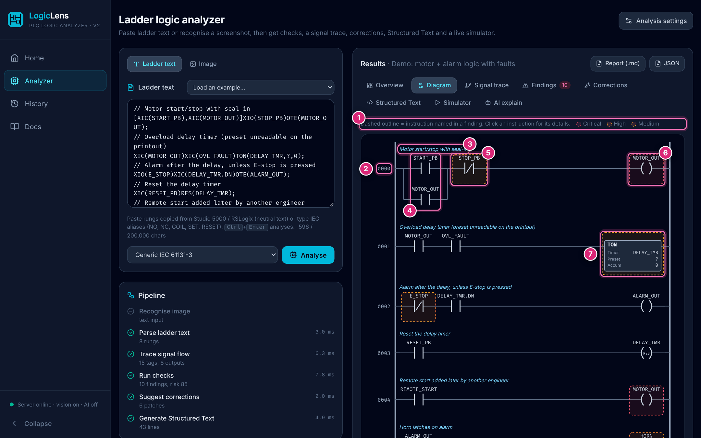

| # | What you see | What it means |
|---|---|---|
| 1 | Legend | A dashed outline marks an instruction named in a finding, and its colour shows the severity. Click any instruction for its details. |
| 2 | Rung number | Rung 0000, numbered as in the PLC software. |
| 3 | Rung comment | The `//` comment written above the rung. |
| 4 | Seal-in branch | START_PB in parallel with MOTOR_OUT keeps the motor running after Start is released. |
| 5 | Flagged contact (medium) | STOP_PB is examined with XIO (normally-open instruction). If the stop button is wired normally-closed, as stop buttons usually are, the motor can never start. |
| 6 | Flagged coil (critical) | MOTOR_OUT is written here and again in rung 4: the duplicate coil. |
| 7 | Timer block | TON DELAY_TMR with preset `?`. The preset was unreadable on the printout, so it is flagged instead of guessed. |

### 5. Signal trace

For every output, the condition that drives it, written as logic.

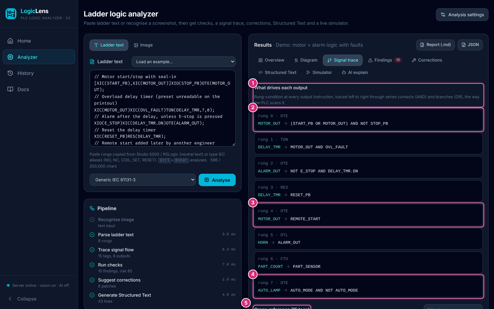

| # | What you see | What it means |
|---|---|---|
| 1 | What drives each output | Each rung's condition, read the way the PLC scans it: series contacts are AND, parallel branches are OR. |
| 2 | Rung 0 | MOTOR_OUT = (START_PB OR MOTOR_OUT) AND NOT STOP_PB: the start/stop circuit with its seal-in. |
| 3 | Rung 4 | MOTOR_OUT is driven again, by REMOTE_START alone. This is the second writer behind the duplicate-coil finding. |
| 4 | Rung 7 | AUTO_MODE AND NOT AUTO_MODE can never be true, so AUTO_LAMP can never light. This is the dead-rung finding. |
| 5 | Cross-reference | Further down: every tag, with the rungs that read and write it, and a filter. |

### 6. Corrections

Suggested fixes as patches you can review, select and load into the editor.

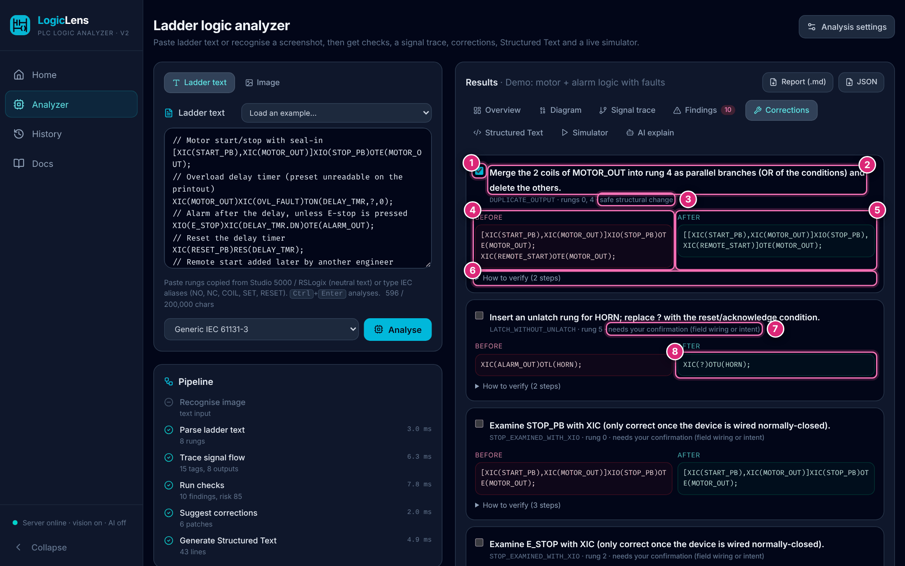

| # | What you see | What it means |
|---|---|---|
| 1 | Select | Tick the patches you want to apply. |
| 2 | What the patch does | Merges the two MOTOR_OUT coils into one rung, with their conditions as parallel branches. |
| 3 | Safe structural change | The fix changes structure only and needs no decision from you, so it starts selected. |
| 4 | Before | The rungs as they are now. |
| 5 | After | The rungs after the fix. |
| 6 | How to verify | Steps to test the change before it reaches a PLC. |
| 7 | Needs your confirmation | This fix depends on field wiring or intent, so it starts unselected. |
| 8 | `?` placeholder | The reset condition for HORN is unknown. You fill in the reset or acknowledge signal. |

Below the list, **Load corrected program into the editor** applies the selected patches and analyses
the result again.

### 7. Structured Text

The same program as IEC 61131-3 Structured Text, ready to paste into a PLC project.

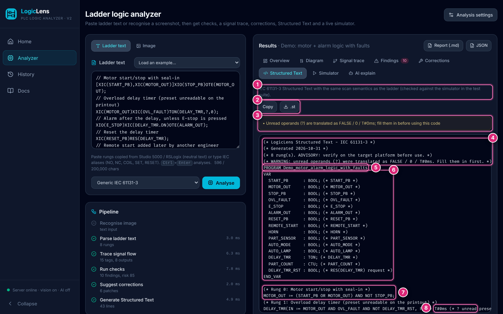

| # | What you see | What it means |
|---|---|---|
| 1 | Description | The code behaves like the ladder, scan for scan. The test suite checks this against the simulator on 600 random programs. |
| 2 | Copy and download | Copies the code, or saves it as a `.st` file. |
| 3 | Warning | Unread operands (`?`) become FALSE, 0 or T#0ms in the code. Fill them in before using it. |
| 4 | Header | Program name, date, rung count, an advisory and the same warning, as comments in the code. |
| 5 | Program name | Taken from the program's name: the example name, or the image file. |
| 6 | Declarations | Every tag with its inferred type (BOOL, TON, CTU), plus helper variables such as the timer reset request. |
| 7 | Rung 0 as code | `MOTOR_OUT := (START_PB OR MOTOR_OUT) AND NOT STOP_PB;`, with the rung comment above it. |
| 8 | Unread preset | The timer preset that could not be read is marked in the code itself. |

### 8. Simulator

The motor-starter example, running. Start was pressed and released, and the seal-in keeps the
motor on.

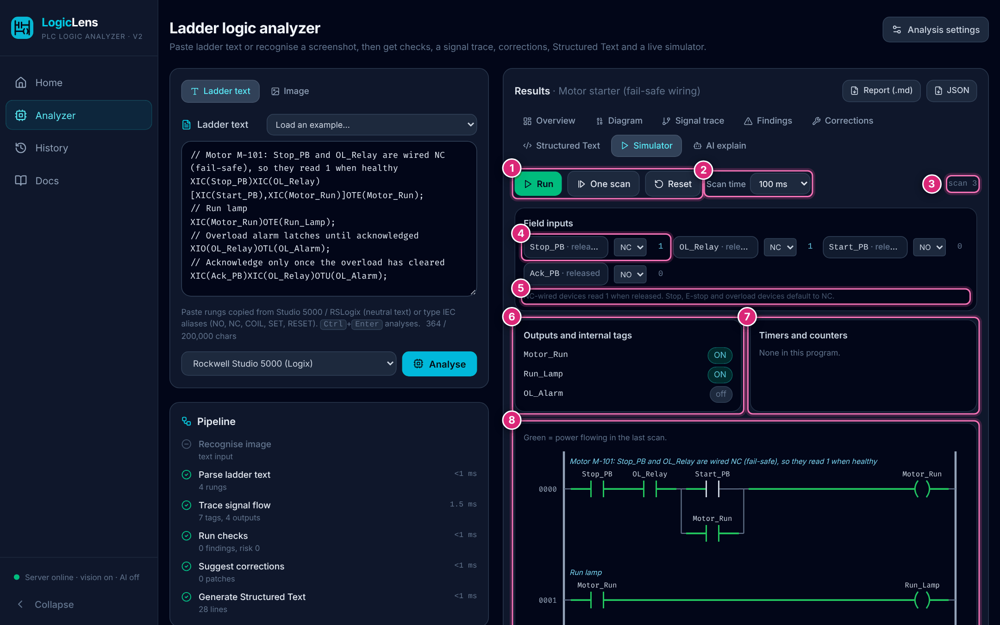

| # | What you see | What it means |
|---|---|---|
| 1 | Run controls | **Run** scans continuously, **One scan** steps once, **Reset** clears every value. |
| 2 | Scan time | How long each simulated scan takes. Timers advance by this much per scan. |
| 3 | Scan counter | Scans run so far (3). |
| 4 | A field input | Click the name to press or release it. NO/NC sets how the device is wired. The number is what the PLC reads: Stop_PB is wired NC, so it reads 1 while released. |
| 5 | Wiring note | Stop, E-stop and overload devices default to NC, so they read 1 when healthy. |
| 6 | Outputs | Motor_Run and Run_Lamp are ON, OL_Alarm is off. |
| 7 | Timers and counters | Live accumulated time and counts. This program has none. |
| 8 | Live ladder | Green shows where power flowed in the last scan, rung by rung. |

### 9. Screenshot recognition, step 1: recognise

A real RSLogix 500 screenshot, dropped into the **Image** tab and recognised.

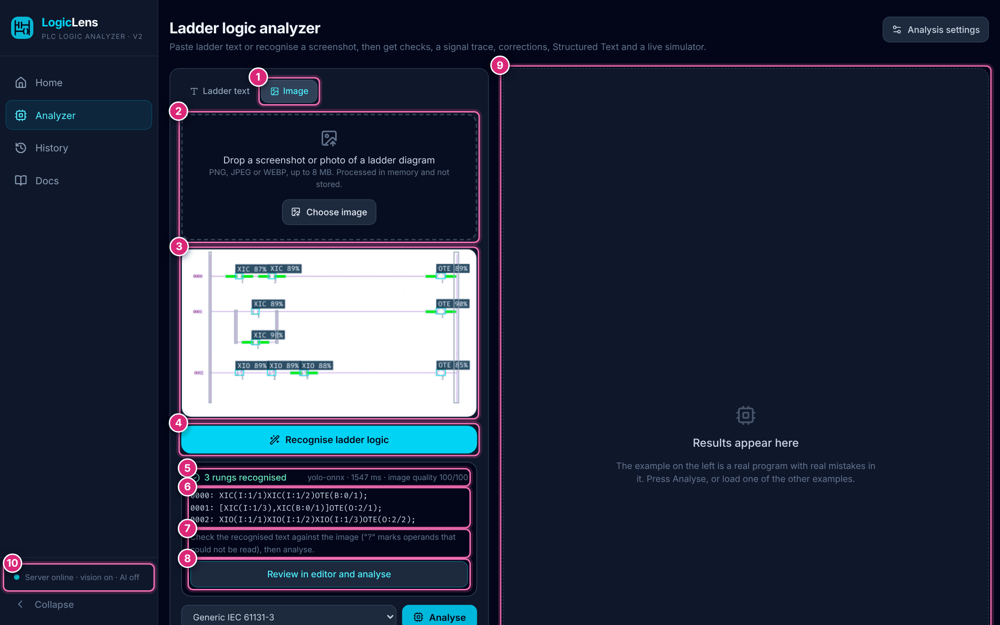

| # | What you see | What it means |
|---|---|---|
| 1 | Image input | Switches from text to image. |
| 2 | Drop zone | Drag in a screenshot or photo, or choose a file. PNG, JPEG or WEBP up to 8 MB, processed in memory and never stored. On a phone there is also a **Take photo** button. |
| 3 | Detected instructions | Every symbol the detector found, boxed and labelled with the instruction and its confidence (XIC 87 %, OTE 89 % and so on). |
| 4 | Recognise | Sends the image to the recognition server. |
| 5 | Result summary | 3 rungs recognised by the `yolo-onnx` engine in about 1.5 s, image quality 100/100. |
| 6 | Recognised ladder text | The rungs as text, including the parallel branch in rung 0001 and every address read by OCR. It matches the hand-written ground truth exactly. |
| 7 | Review hint | Check the text against the image. `?` marks anything that could not be read. |
| 8 | Review in editor and analyse | Copies the text into the editor and runs the analysis (step 10). |
| 9 | Results area | Stays empty until you have reviewed the recognised text. |
| 10 | Server status | "vision on": the recognition engine is ready. |

### 10. Screenshot recognition, step 2: analyse

The recognised program, analysed like any other.

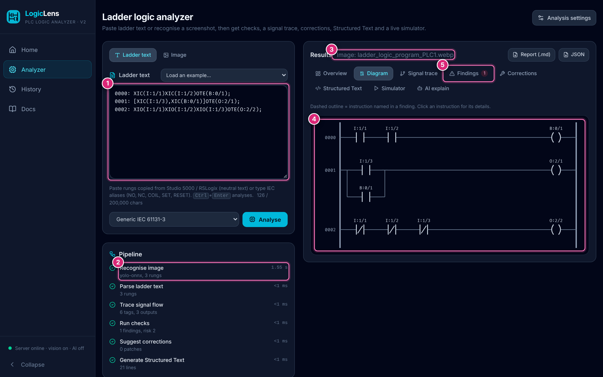

| # | What you see | What it means |
|---|---|---|
| 1 | Editor | The recognised rungs with their rung numbers. Edit anything and analyse again. |
| 2 | Pipeline | The first stage now ran: Recognise image, yolo-onnx, 3 rungs, 1.51 s. |
| 3 | Program name | Named after the image file. |
| 4 | Redrawn diagram | The screenshot's program drawn as a clean ladder: two contacts in series, a parallel branch, three NC contacts. |
| 5 | Findings | 1 low finding: none of the 3 rungs has a comment. |

### 11. History

Every analysis is kept in your browser so you can come back to it.

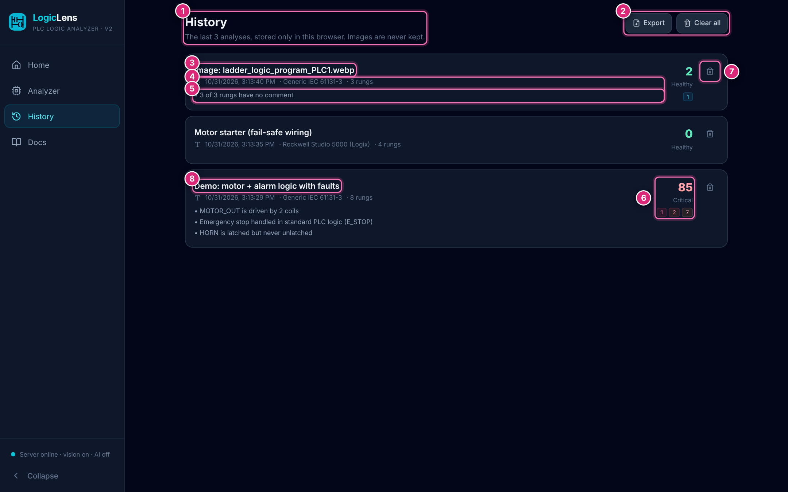

| # | What you see | What it means |
|---|---|---|
| 1 | History | The last analyses (up to 50), stored only in this browser. Images are never kept. |
| 2 | Export and Clear all | Downloads the history as JSON, or deletes it. |
| 3 | From an image | Named after the screenshot it came from. |
| 4 | Details | Source (image or text), date and time, platform and number of rungs. |
| 5 | Top findings | The most important findings at a glance. |
| 6 | Risk score | Score, grade and findings per severity: 1 critical, 2 high, 7 medium. |
| 7 | Delete | Removes this entry. |
| 8 | Reopen | Click a name to open that analysis in the Analyzer again. |

## Quick start

| Option | How | Needs |
|---|---|---|
| **No install** | Open [`LogicLens.html`](LogicLens.html) in a browser: the whole app in one file | A browser |
| **Windows, full app** | Double-click [`Start-LogicLens.cmd`](Start-LogicLens.cmd) | Node.js 20+, Python 3.11 to 3.13, [Tesseract OCR](https://github.com/UB-Mannheim/tesseract/wiki) for tag names |
| **Docker** | `docker compose up --build`, then open http://localhost:8080 | Docker |

`LogicLens.html` runs text analysis, all checks, Structured Text and the simulator offline.
Screenshot recognition and AI need the API, which the other two options start.

On its first start, `Start-LogicLens.cmd` installs the web packages (1 to 2 minutes) and the API's
Python packages (2 to 5 minutes, in the "LogicLens API" window). After that it starts in seconds
and opens http://localhost:5173. Close both windows to stop. Double-clicking it again while
LogicLens is running just reopens the browser.

Manual setup is under [Development](#development).

## How it works

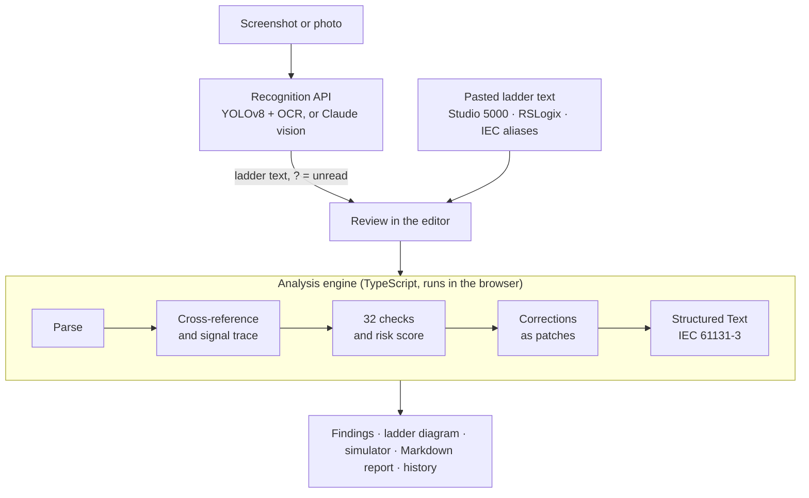

Input is **LogicLens Ladder Text**: the neutral text that Studio 5000 and RSLogix copy to the
clipboard, plus IEC aliases (`NO`, `NC`, `COIL`, `SET`, `RESET`). The grammar, limits and error
codes are in [`contract/README.md`](contract/README.md). The TypeScript and Python parsers share
37 test vectors and must agree on every one.

```text
// Motor start/stop with seal-in
[XIC(START_PB),XIC(MOTOR_OUT)]XIO(STOP_PB)OTE(MOTOR_OUT);
// Overload delay timer (preset unreadable on the printout)
XIC(MOTOR_OUT)XIC(OVL_FAULT)TON(DELAY_TMR,?,0);
```

On the built-in demo program (8 rungs) LogicLens reports a risk score of 85/100: 1 critical,
2 high and 7 medium findings, with 6 suggested patches.

## What it checks

| Area | Checks |
|---|---|
| Outputs and coils | `DUPLICATE_OUTPUT` · `MIXED_OUTPUT_TYPES` · `LATCH_WITHOUT_UNLATCH` · `UNLATCH_WITHOUT_LATCH` · `UNCONDITIONAL_OUTPUT` · `MISSING_SEAL_IN` |
| Safety | `ESTOP_IN_STANDARD_LOGIC` · `STOP_EXAMINED_WITH_XIO` · `MISSING_INTERLOCK` · `BRANCH_BYPASSED` |
| Logic (satisfiability) | `DEAD_RUNG` · `CONTRADICTORY_CONTACTS` · `ALWAYS_TRUE` · `REDUNDANT_CONTACT` · `SCAN_ORDER_DELAY` |
| Timers and counters | `TIMER_INSTANCE_REUSED` · `TIMER_PRESET_INVALID` · `UNDEFINED_TIMER_REFERENCE` · `RTO_NO_RESET` · `COUNTER_PRESET_INVALID` · `COUNTER_NO_RESET` · `ONE_SHOT_STORAGE_REUSED` |
| Program flow | `JUMP_TARGET_MISSING` · `LABEL_DUPLICATE` · `LBL_NOT_FIRST` · `BACKWARD_JUMP` · `MCR_UNBALANCED` |
| Data | `DIVIDE_BY_ZERO` · `UNKNOWN_OPERANDS` |
| Maintainability | `UNUSED_INTERNAL` · `MISSING_COMMENT` · `NAMING_INCONSISTENCY` |

Each check is either a deterministic rule (exact for the logic shown) or a heuristic that depends
on tag names, and every finding says which one it is. The risk score combines all findings, with
weights $w$ = 0.45 (critical), 0.25 (high), 0.10 (medium) and 0.02 (low):

$$\text{risk} = 100 \times \Big(1 - \prod_{\text{findings}} (1 - w)\Big)$$

## Architecture

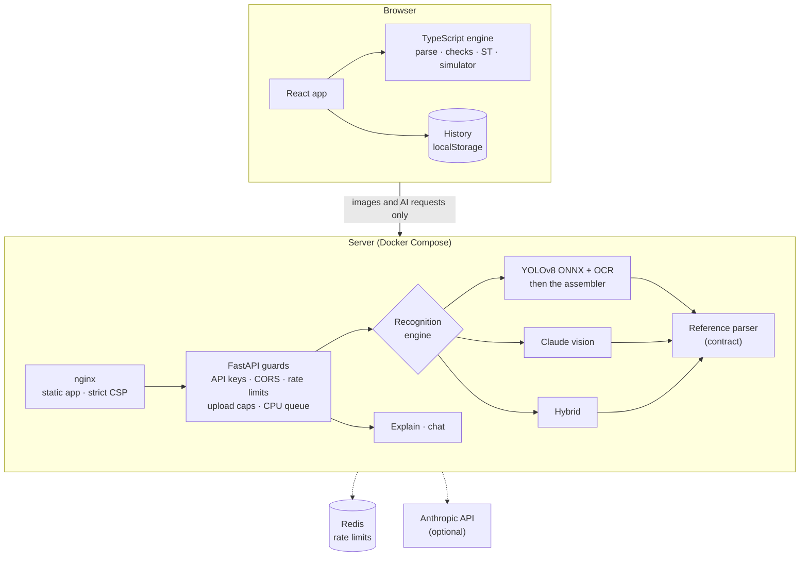

- **The analysis never leaves the browser.** The server is only needed to read images and for the optional AI features.
- **Four recognition engines.**
  - `yolo-onnx`: detector plus OCR, CPU only.
  - `claude-vision`: Claude reads the image.
  - `hybrid`: YOLO boxes guide Claude's reading, and each half falls back to the other.
  - `stub`: for demos.
  - `LOGICLENS_ENGINE=auto` picks the best engine that is configured.
- **Hardened uploads with zero retention.**
  - Uploads are streamed with a size cap, checked by magic bytes and decoded with pixel caps to stop decompression bombs.
  - Images are never written to disk.
  - A bounded CPU queue answers `503` with `Retry-After` instead of falling over, and the web app retries.
- **Security in depth.** The API supports optional API keys, Redis-backed rate limits (separate ones for AI calls) and a CORS allow-list. nginx applies a strict Content Security Policy, and the containers run read-only.

### Screenshot recognition, step by step

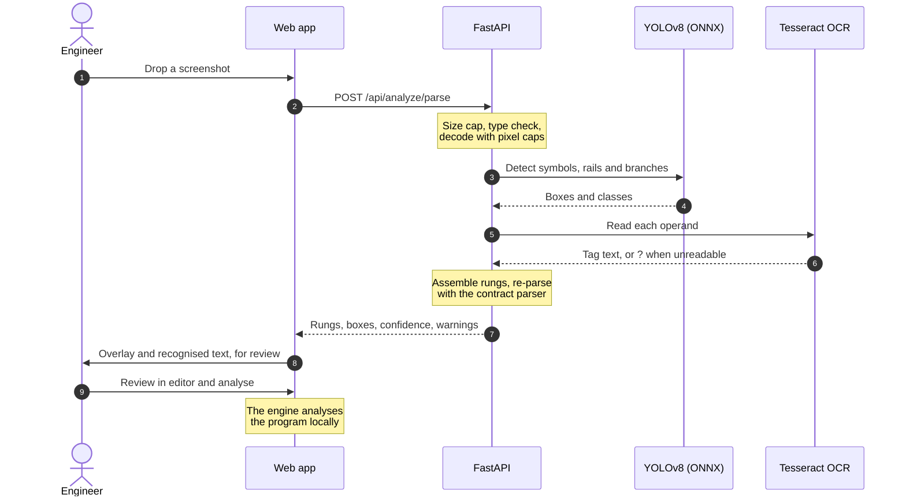

## The model

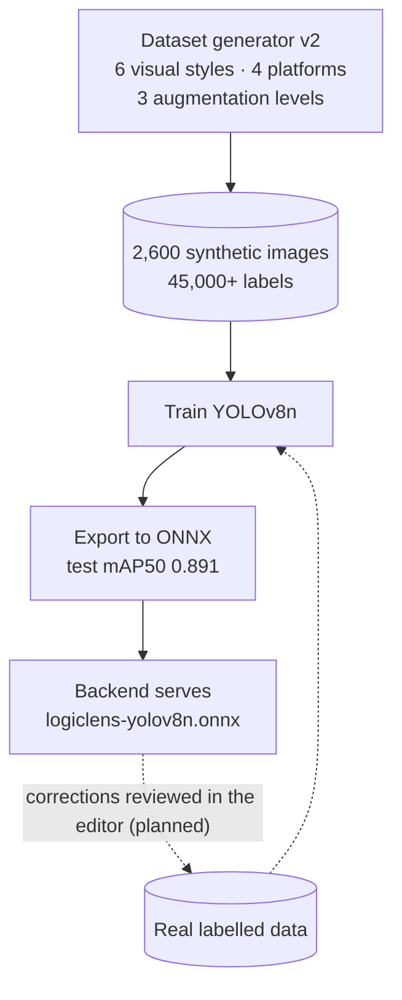

The generator in [`ml/generator/`](ml/generator) draws ladder diagrams the way real tools do:

- **Visual styles:** Studio 5000, RSLogix 500, TIA Portal, IEC, dark themes and printed pages.
- **Labels:** tight boxes for every symbol, plus the power rails and branch connectors that the assembler needs to rebuild rungs.

Details are in [`ml/models/model_card.md`](ml/models/model_card.md) and
[`ml/reports/dataset_report.md`](ml/reports/dataset_report.md).

## Measured results

| What | Result | Source |
|---|---|---|
| Detector, synthetic test split (300 images) | mAP50 0.891 · mAP50-95 0.821 · precision 0.84 · recall 0.86 | [`metrics.json`](ml/models/metrics.json) |
| Real RSLogix 500 screenshot | All 3 rungs and every operand exact | [`sample_prediction.json`](ml/reports/sample_prediction.json) |
| End to end, 150 synthetic test images | Instruction F1 0.84 · operands read 44 % · whole program exact 2.7 % | [`e2e_eval.json`](ml/reports/e2e_eval.json) |
| Analysis of a 2,000-rung program | About 0.55 s in the browser | [`performance.test.ts`](web/tests/integration/engine/performance.test.ts) |
| Text API under load | 800 virtual users · about 990 requests/s · p95 310 ms · 0 errors | Load test (gate 6) |
| Image recognition under load | About 1.8 images/s on 2 CPU cores · 0 failed requests | Load test (gate 6) |

The detector finds the symbols well. Reading the small operand text is the weak link. That is why
recognised programs open in the editor for review, with `?` marking anything unread, and why the
hybrid engine exists: YOLO finds the boxes and Claude reads them.

## How it's tested

Every package went through the same six gates:

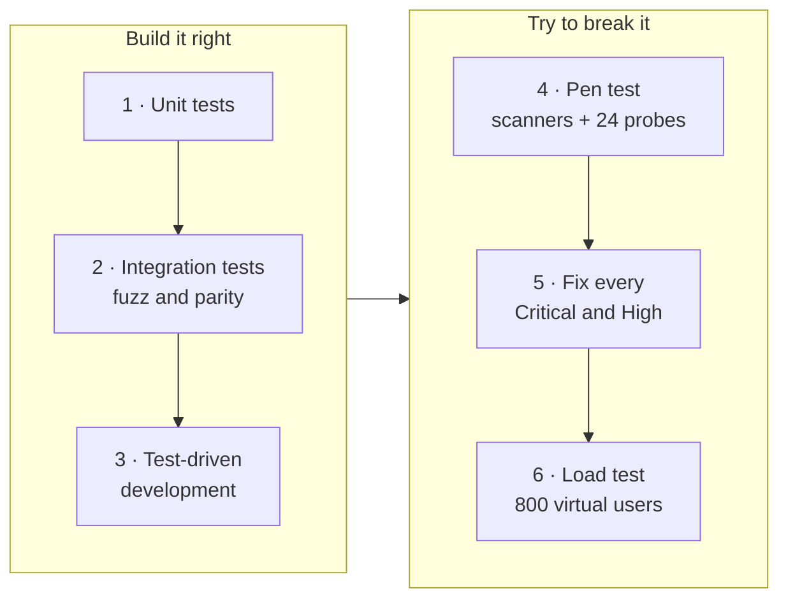

| Package | Tests | Highlights |
|---|---|---|
| `web/` | 379 | Engine line coverage 98.6 %. TS and Python parsers agree on 3,000 generated inputs. 2,000 random programs × 200 scans of fuzzing. Generated Structured Text matches the simulator on 600 random programs |
| `backend/` | 352 | Integration runs against real Tesseract, onnxruntime and Redis. Security probes cover uploads, decompression bombs, CORS, spoofed forwarding headers and auth |
| `ml/` | 144 + 3 expected failures | Generator, decoder parity with the backend, end-to-end evaluation |
| `contract/` | 72 | Reference parser and the shared test vectors |

**Security.** Scanned with npm audit, pip-audit, bandit and semgrep (OWASP rules), plus 24 hand-written API probes.

- All Critical and High findings were fixed: 1 Critical and 3 High.
- Of 8 Medium findings, 6 were fixed and 1 was a false positive.
- 1 Medium is still open: the Claude paths need a probe with a live API key.

## Development

```bash
# Web app: http://localhost:5173 (proxies /api to 127.0.0.1:8000)
cd web && npm ci && npm run dev
npm test                      # unit + integration
npm run build:standalone      # rebuilds LogicLens.html

# API: Python 3.11 to 3.13, Tesseract on PATH for tag names
cd backend && pip install -r requirements.txt
LOGICLENS_YOLO_ONNX=../ml/models/logiclens-yolov8n.onnx python -m uvicorn app.main:app --port 8000
python -m pytest
```

The npm scripts call `node node_modules/...` directly on purpose. npm's Windows `.cmd` shims
break in folders whose path contains `&`.

### API

| Method | Path | Purpose |
|---|---|---|
| `GET` | `/health` | Liveness and version |
| `GET` | `/api/meta` | Active engine, limits, AI status |
| `POST` | `/api/analyze/parse` | Image to program JSON (multipart `file`, optional `platform`) |
| `POST` | `/api/analyze/text` | Ladder text to program JSON |
| `POST` | `/api/analyze/explain` | Claude explanation of a program and its findings |
| `POST` | `/api/chat` | Follow-up questions about a program |

Every error uses one envelope, `{"error": {"code", "message", "request_id", "details"}}`, described in
[`contract/README.md`](contract/README.md#5-error-envelope-all-backend-errors).

### Configuration

| Variable | Default | Purpose |
|---|---|---|
| `LOGICLENS_ENGINE` | `auto` | `auto`, `yolo`, `claude`, `hybrid` or `stub` |
| `LOGICLENS_YOLO_ONNX` | not set | Path to the detector, e.g. `ml/models/logiclens-yolov8n.onnx` |
| `ANTHROPIC_API_KEY` | not set | Turns on Claude vision, explain and chat |
| `LOGICLENS_API_KEYS` | not set (open) | Comma-separated keys that clients send in `X-API-Key` |
| `REDIS_URL` | not set (in-memory) | Shared rate limits across workers |
| `LOGICLENS_CORS_ORIGINS` | `http://localhost:5173` | Allowed browser origins |
| `LOGICLENS_OCR` / `LOGICLENS_TESSERACT_CMD` | `true` / `tesseract` | Operand OCR |
| `LOGICLENS_MAX_UPLOAD_MB` | `8` | Upload cap |
| `LOGICLENS_DOCS` | `false` | Serves the OpenAPI docs at `/docs` |

### Project structure

```text
├── contract/             Ladder text grammar, program JSON schema, detector classes, shared test vectors
├── web/                  React app + TypeScript engine (parse, trace, checks, corrections, ST, simulator)
├── backend/              FastAPI: recognition engines, Claude explain/chat, security, Dockerfile
├── ml/                   Dataset generator, training / export / evaluation tools, pilot ONNX model
├── samples/              Real RSLogix 500 screenshot used in tests
├── docs/images/          README screenshots
├── LogicLens.html        Single-file build: open it, no install
├── Start-LogicLens.cmd   Windows launcher
└── docker-compose.yml    nginx + FastAPI + Redis
```

## Roadmap

- **Real training data.** Synthetic data took the pilot to 0.89 mAP50. Real HMI photos and IDE screenshots with corrected labels are what will raise end-to-end accuracy. Every correction made in the editor is such a label, collected with consent.
- **Hybrid engine in production.** It is implemented and tested against a fake client. Next is a live-key probe before users see it.
- **Hosted SaaS.** Accounts and billing.
- **Android.** The web app is an installable PWA. Next is a Capacitor or Trusted Web Activity wrapper for the Play Store.

## Safety

LogicLens is advisory. It does not certify safety functions (IEC 61508 / IEC 61511) and cannot see
field wiring or hardware configuration. A qualified engineer must verify any change before it
reaches a live system. Emergency stops belong in hard-wired or safety-rated circuits, which is also
what the `ESTOP_IN_STANDARD_LOGIC` check says.

## License

Copyright (C) 2026 Mahim Trivedi.

LogicLens is free software under the [GNU Affero General Public License v3.0](LICENSE). If you run a
modified version as a network service, you must offer its source code to the users of that service.
The pilot detector is trained with [Ultralytics YOLOv8](https://github.com/ultralytics/ultralytics),
which is also AGPL-3.0.
